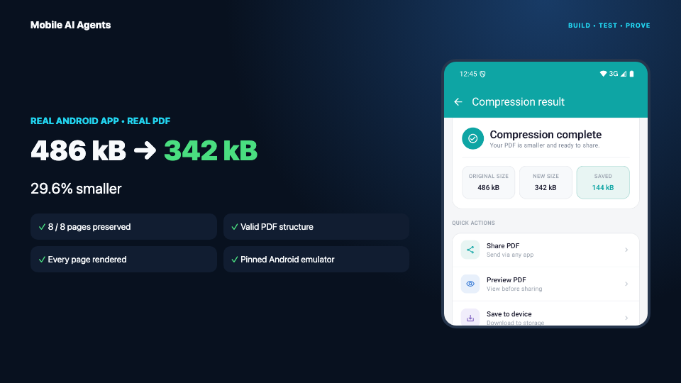
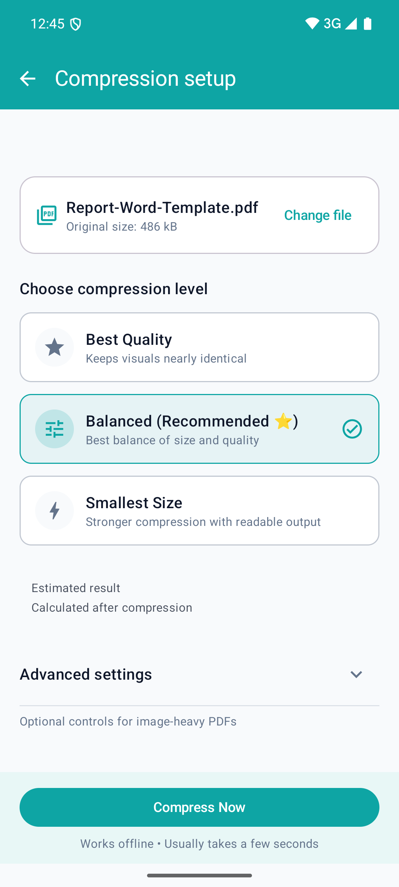
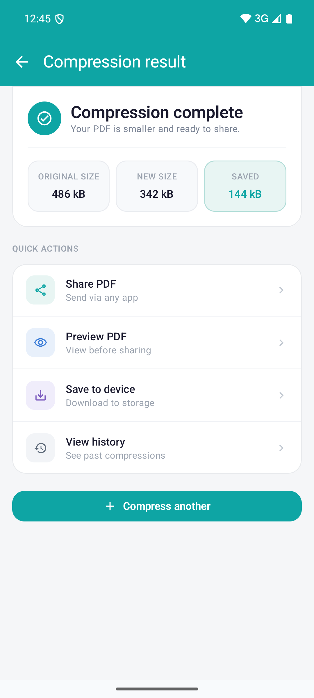

# Case Study: Proving PDF Compression On Android

Mobile AI Agents was run against a real Kotlin/Jetpack Compose PDF Compressor—not a toy fixture—to demonstrate the difference between a successful UI flow and verified output.

[▶ Watch the 45-second Mobile QA demonstration](assets/mobile-ai-agents-mobile-qa-demo.mp4)



## Verified result

| Check | Evidence | Result |
|---|---|---|
| Clean build | 274 Gradle tasks | PASS |
| Project-owned tests | App, home, cropper | PASS |
| Android install/launch | Android emulator | PASS |
| Balanced result | 485,807 → 342,067 bytes | PASS |
| Reduction | 29.59% | PASS |
| Page preservation | 8 → 8 pages | PASS |
| PDF structure | `pdfinfo` opens output | PASS |
| Rendering | 8 pages rendered at 144 DPI | PASS |
| Visible quality review | First/final pages readable | PARTIAL |
| Full fixture matrix | Synthetic fixtures missing | BLOCKED |





## Reproduce it

```bash
npx mobile-ai-agents doctor --platform android
npx mobile-ai-agents install --platform android --tool codex
npx mobile-ai-agents mcp setup --client codex
npx mobile-ai-agents mcp config init \
  --app-id com.example.app \
  --apk app/build/outputs/apk/debug/app-debug.apk \
  --flow "Launch|Select PDF|Compress|Preview|Save"
npx mobile-ai-agents mcp config validate
```

Then run `/mobile-mcp-qa` inside the configured coding agent and `/file-output-qa` against the exported files. The CLI prepares the environment; it does not currently expose a `qa --flow` executor.

## Honest limitations

- This is one eight-page template, not a universal PDF benchmark.
- Smallest Size reached 222 kB in the UI, but exported-file proof was interrupted, so it is not a file-level PASS.
- Encrypted, corrupt, large scanned, image-heavy, and cancellation fixtures remain open.
- No private document pages are published.

Related: [issue #90](https://github.com/salmanashraf/mobile-ai-agents/issues/90).
